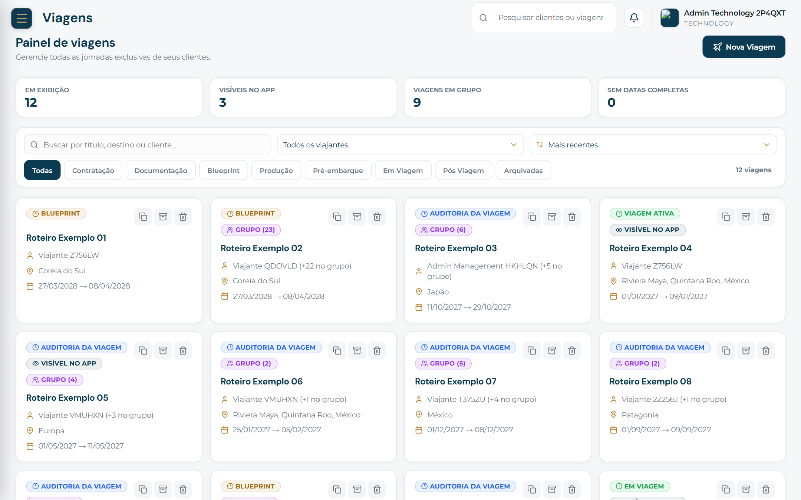
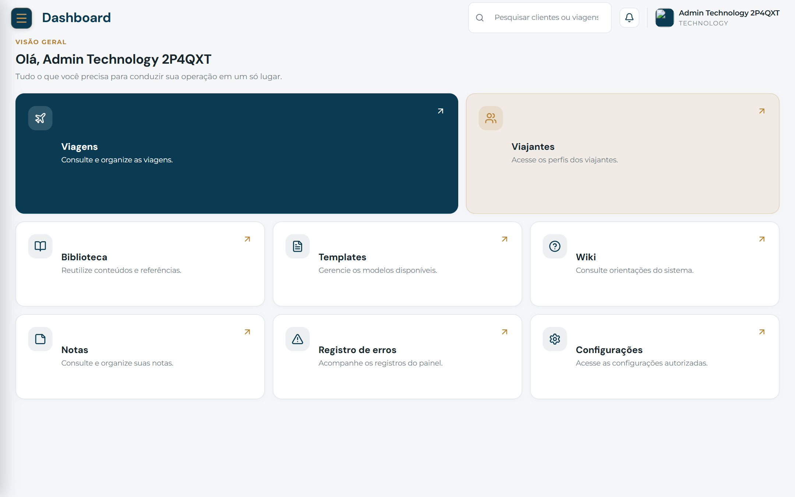
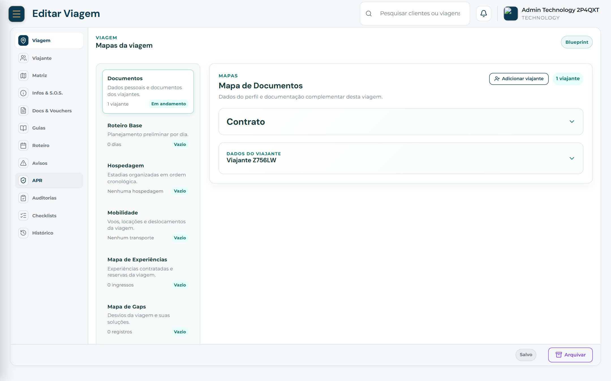
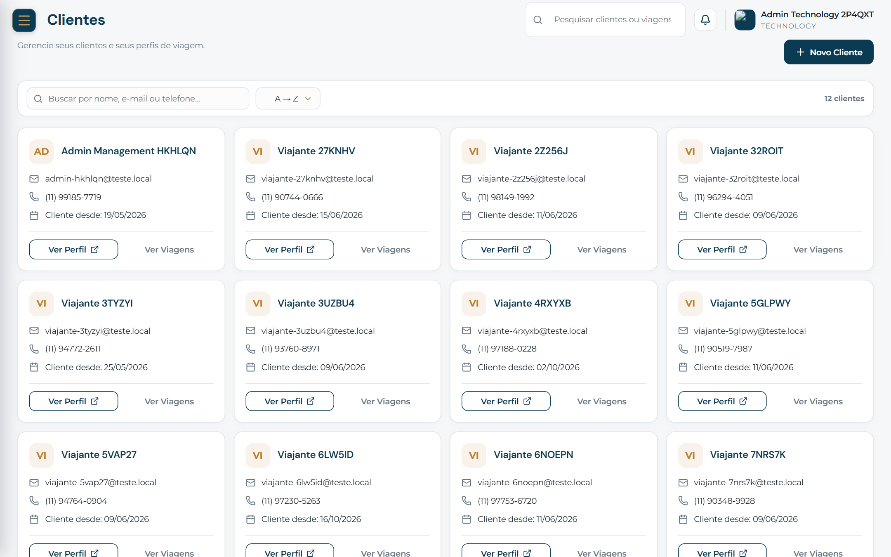
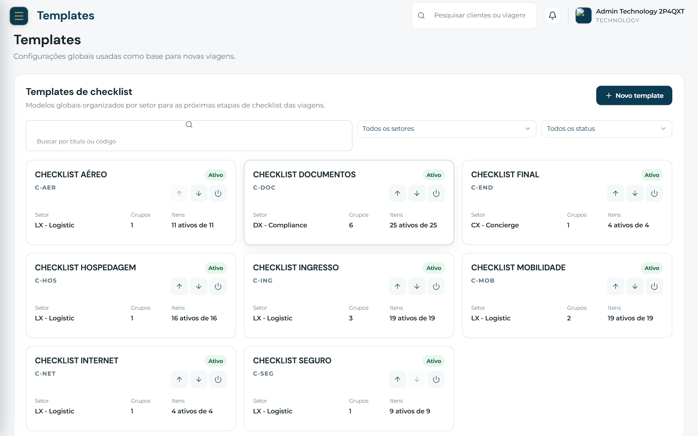
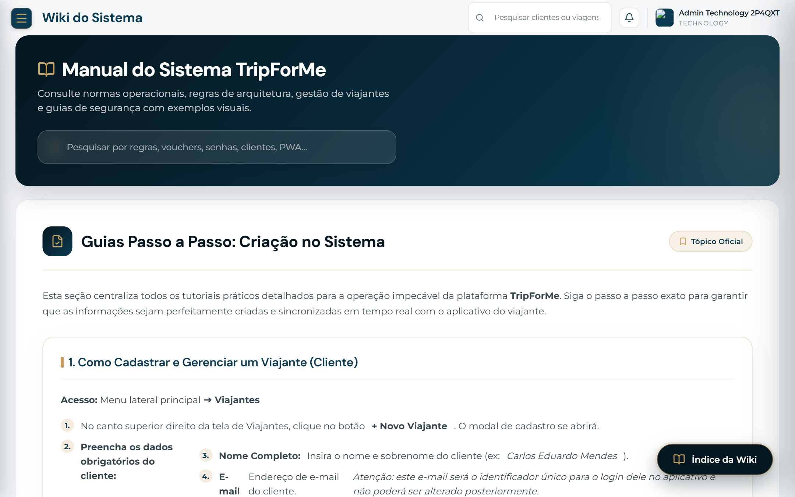
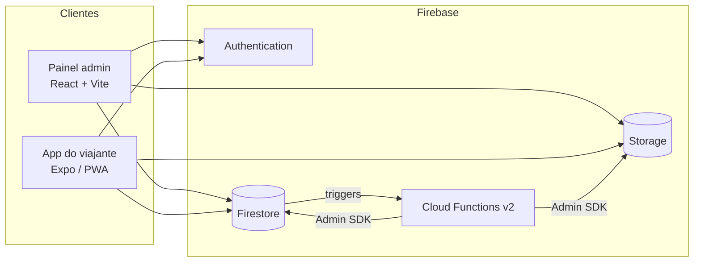

# TripForMe

**Plataforma de curadoria de viagens: painel administrativo para a equipe e aplicativo para o viajante.**

> O projeto está em produção e é usado por uma operação real de viagens. O código-fonte é privado
> porque tem regras de negócio e infraestrutura de produção. Este repositório mostra as telas, a
> arquitetura e as decisões técnicas, e todas as imagens usam **dados fictícios** (cópia anonimizada).

## O problema

Eu construí o painel e o app para organizar e otimizar o trabalho de montar viagens personalizadas em
uma empresa de curadoria de viagens. O painel reúne tudo em um local só para a equipe e ajuda a
gerenciar melhor as crises e o dia a dia. O app entrega ao viajante o roteiro, os documentos e os
avisos da própria viagem.

## O que o sistema faz

| Área | O que resolve |
|---|---|
| **Viagens** | Funil por etapa (contratação, documentação, produção, pré-embarque, em viagem, pós-viagem), viagens em grupo, visibilidade no app |
| **Editor de viagem** | Mapas operacionais (documentos, hospedagem, mobilidade, experiências, gaps), roteiro por dia, guias, avisos, auditorias e checklists |
| **Clientes** | Perfis de viajantes e histórico de viagens |
| **Biblioteca** | Banco de viagens, eventos, dias de roteiro e guias reutilizáveis |
| **Templates** | Checklists globais por setor, com grupos e itens ativáveis |
| **Permissões** | Acesso por setor, módulo e ação, aplicado no servidor |
| **Wiki** | Manual interno do sistema dentro do próprio painel |
| **App do viajante** | Roteiro, vouchers e guias da viagem, publicado como PWA |

## Telas

| | |
|---|---|
|  |  |
| Dashboard por módulo | Editor de viagem: mapas operacionais |
|  |  |
| Clientes | Templates de checklist por setor |

## Arquitetura (resumo)

Detalhes em [docs/arquitetura.md](docs/arquitetura.md).

## Destaques técnicos

- **Manter o projeto dentro dos limites gratuitos do Firebase.** Foi o problema mais difícil. Um
  pico de leituras causado por desenvolvimento apontado para produção mostrou onde o custo estava,
  então separei o ambiente de desenvolvimento e mapeei os pontos que mais leem o Firestore, como
  listeners, varreduras de Storage e listagens de coleções inteiras, para otimizar por prioridade.
- **Ambiente local com dados anonimizados.** Um comando sobe emuladores do Firebase com uma cópia
  anonimizada da produção, e a cópia é recusada se algum e-mail, telefone ou nome real passar. As
  telas deste repositório saíram desse ambiente.
- **Permissões decididas no servidor.** O acesso vem das Firestore Rules, a partir de uma matriz de
  setor, módulo e ação. A interface só mostra o que as Rules já permitem.
- **Testes.** As Rules e a integração rodam contra emuladores, além dos testes unitários (Vitest no
  painel e nas Functions, Jest no app).
- **Limpeza segura de arquivos.** A fila de exclusão do Storage confere se o arquivo é usado por
  outro template, viagem ou usuário antes de apagar.
- **Documentação junto do código.** Arquitetura, segurança, migração, testes e decisões ficam
  versionados com o projeto. Veja [docs/decisoes.md](docs/decisoes.md).

## Stack

- **Painel:** React 19, TypeScript, Vite 6, Sass (SCSS modules), Vitest
- **App:** Expo 54 / React Native, React Navigation, Jest, publicado como PWA
- **Backend:** Firebase (Auth, Firestore, Storage, Hosting, App Check), Cloud Functions v2 em
  TypeScript, funções serverless na Vercel
- **Qualidade:** testes unitários e de integração, emuladores, `tsc --noEmit`

## Contato

Douglas Viegas · [github.com/doug-viegas-dev](https://github.com/doug-viegas-dev)
· douglasviegas97@gmail.com · (53) 99942-4900
