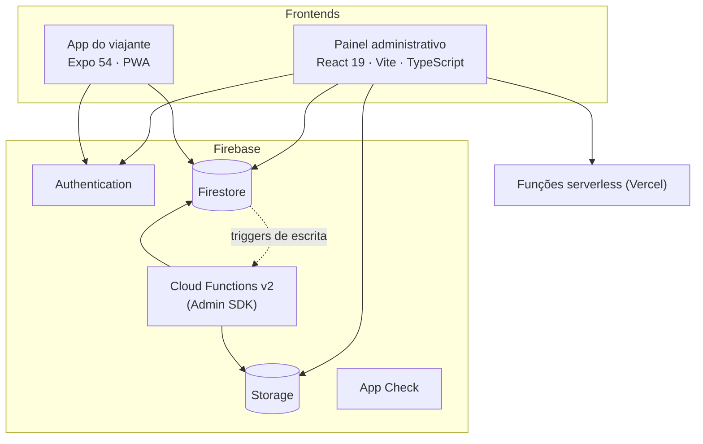
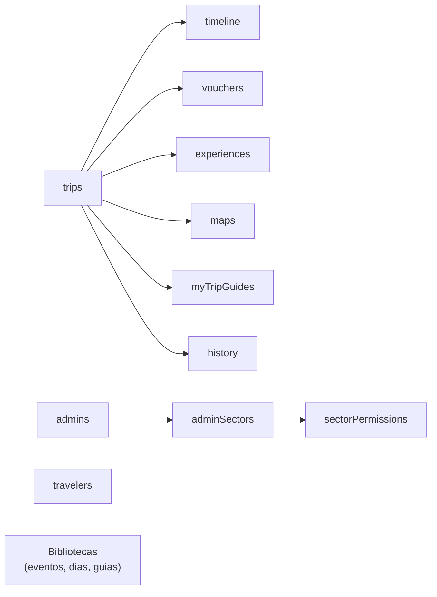
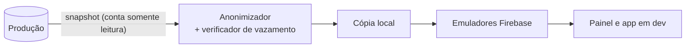

# Arquitetura

Visão geral de como as peças do TripForMe se encaixam. Nomes de projeto, IDs e caminhos de
infraestrutura foram omitidos de propósito.

## Componentes



- **Painel**: navegação por módulos, sem router de terceiros para o fluxo principal. Todo acesso ao
  Firebase passa por uma camada de serviços (`*Service.ts`); os componentes só consomem serviços.
- **App**: mesmo backend, escopo restrito às viagens do próprio viajante.
- **Cloud Functions**: backend privilegiado. Como o Admin SDK ignora as Rules, cada função faz sua
  própria autorização.
- **App Check** reduz uso indevido dos recursos, mas não substitui autenticação nem autorização.

## Modelo de dados (Firestore)



- `trips` é a coleção central. Cada viagem tem subcoleções de linha do tempo, vouchers,
  experiências e mapas operacionais (contrato, documentos, hospedagem, mobilidade).
- Perfil de admin, setor e permissões ficam em coleções próprias; as Rules leem esses documentos
  para decidir cada requisição.

## Autorização

```
requisição ──> Firestore Rules ──> perfil do admin ──> setor ──> matriz setor → módulo → ação
```

O frontend nunca é o controle de acesso: esconder um botão é conveniência, a permissão real é
verificada no servidor. As Rules têm testes automatizados rodando contra o emulador.

## Ambiente de desenvolvimento



O desenvolvimento diário nunca lê produção. A cópia é gerada sob demanda por uma conta de serviço
somente leitura, anonimizada (e-mails, telefones, nomes e arquivos de viajantes) e só é gravada se o
verificador não encontrar nenhum dado real. Ver [decisoes.md](decisoes.md).
